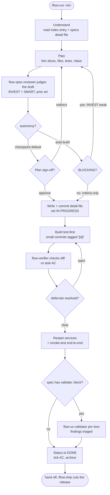

# flow-toolkit

A Claude Code **plugin** for a conversational, spec-driven development workflow — a set of `/flow:*` slash commands, sub-agents, and always-on hooks. Works in any project (.NET, Node, Python, whatever) by reading plain markdown that lives in your repo: `CLAUDE.md` for the rules, and a **spec model** — a lightweight backlog index plus one detail file per spec. Track the backlog locally or on an external board (e.g. Azure DevOps) via a small config file — same spec files either way.

**New here?** This README gets you installed and running. For the full manual — every command, sub-agent, and hook with examples — see **[docs/guide.md](docs/guide.md)**. For diagrams of how it all fits together, see **[docs/how-it-works.md](docs/how-it-works.md)**.

---

## Contents

- [Install](#install)
  - [Migrating from the pre-plugin installer](#migrating-from-the-pre-plugin-installer)
  - [Fallback installer](#fallback-installer)
- [Quick Start](#quick-start)
- [The development cycle](#the-development-cycle)
- [What's in the box](#whats-in-the-box)
- [Learn more](#learn-more)
- [Updating](#updating)

---

## Install

flow-toolkit installs as a Claude Code **plugin** named `flow`, from its GitHub marketplace:

```
/plugin marketplace add liminalarc/flow-toolkit
/plugin install flow@flow-toolkit
```

Restart Claude Code (or run `/reload-plugins`). Every entry point lives under the `flow:` namespace:

`/flow:run` · `/flow:hunt` · `/flow:init` · `/flow:lint` · `/flow:ship` · `/flow:review` · `/flow:pr` · `/flow:validate`

The plugin bundles everything — skills, sub-agents, and the always-on [hooks](docs/guide.md#5-the-hooks-the-always-on-seatbelt) — and updates are versioned (`/plugin update`). It installs **per Claude profile** (each `~/.claude`, `~/.claude-*`, or `$CLAUDE_CONFIG_DIR`), and its hooks are scoped to the profile that enabled it — enable it in each profile you use.

### Migrating from the pre-plugin installer

**Were you using flow-toolkit before it was a plugin?** Earlier versions were distributed by `git clone` + an `install.{sh,ps1}` force-copy, which created **bare** commands (`/flow`, `/flow-hunt`, …). The plugin replaces those with the namespaced `/flow:*` set. To migrate cleanly:

1. Install the plugin (above) and restart.
2. Verify `/flow:run` responds.
3. **Purge the old manual install** so the plugin is the sole source. From a clone of this repo:
   ```bash
   ./uninstall.sh      # Mac/Linux
   .\uninstall.ps1     # Windows (PowerShell)
   ```
   It removes the toolkit's copied commands/skills/agents/hook-scripts from **every detected profile** and deregisters its `settings.json` hooks (backing up to `settings.json.bak` first), touching nothing else. Restart afterward.

> **Why purging matters:** leftover bare `~/.claude/agents/flow-*.md` files *shadow* the plugin's agents, and old `settings.json` hooks double-fire alongside the plugin's. Purging makes agent dispatch and the guards resolve cleanly to the plugin. (A leftover `commands/CLAUDE.md` from the old installer is left in place — delete it by hand only if it was the toolkit's.)

| Before (bare) | Now (plugin) |
|---|---|
| `/flow` | `/flow:run` |
| `/flow-hunt` | `/flow:hunt` |
| `/flow-init` | `/flow:init` |
| `/flow-lint` | `/flow:lint` |
| `/flow-ship` | `/flow:ship` |
| `/flow-review` | `/flow:review` |
| `/flow-pr` | `/flow:pr` |

### Fallback installer

Where the plugin isn't an option, the legacy installer still works. It force-copies the same commands/skills/agents as **bare** names (`/run`, `/hunt`, … — not `/flow:run`) and registers the hooks in every detected profile's `settings.json` (additive merge, `.bak` backup). It auto-detects every profile — no account names hardcoded.

```bash
git clone https://github.com/liminalarc/flow-toolkit.git
cd flow-toolkit
./install.sh          # Mac/Linux (chmod +x install.sh first)
.\install.ps1         # Windows (PowerShell)
```

It's a **criterion-gated fallback** — retired only once the plugin registers the toolkit's hooks reliably across all profiles **and** every in-use project has migrated (spec 1.2 D5), no fixed date. It overwrites on each run, so keep customizations as project-prefixed commands in a project's `.claude/commands/`, not by editing installed files.

---

## Quick Start

```
# In a new project directory:
/flow:init My SaaS app — React web, Node API, Postgres   # scaffold CLAUDE.md + spec model

/flow:run          # see the backlog
/flow:run 0.1      # plan + build the first spec (pauses for your sign-off)
/flow:ship         # cut the release
```

That's the whole loop. Pass a concept to `/flow:init` or leave it blank to answer conversationally; on an **existing** codebase it reads what's there, skips the walking skeleton, and seeds a real backlog. To track the backlog on an ADO board instead of a local `SPECIFICATIONS.md`, run `/flow:init --backend ado`.

---

## The development cycle

By default (`checkpoint` mode) `/flow:run` never writes code until you approve the plan; a spec can opt into `auto-build` to skip that pause, with an independent verifier as the safety net.

A spec carrying a `repos:` footprint cannot reach `DONE` while another repo's slice is unbuilt — flat-file refuses the status change, ado declines to propose the card transition and offers a confirm-first override. Completion is recorded per repo: each repo's own index in flat-file mode, a `slice-done:<repo>` card tag in ado. It also opens with a **cross-repo banner** — the full footprint, which slice this run builds, where each sibling's slice lives and whether it is done — and closes with a reminder of the siblings still outstanding. Both are advisory; flow reads a sibling and never builds one.



**The spec gets a second set of eyes:** before you sign off — and before `auto-build` writes anything — an independent read-only agent judges the draft spec on **INVEST** (is this one shippable story?) and each acceptance criterion on **SMART** (is this line actually provable?), and checks it against decisions already settled in your archive. Under `checkpoint` the verdict is advisory, next to the plan you're already reading. Under `auto-build` it gates by altitude: a weak **INVEST** letter means the spec is mis-shaped, so it blocks, gets one bounded revision, then escalates to you — while a criterion that just needs sharpening is surfaced and built through. It critiques but never authors — the same separation that keeps the verifier from patching its own findings.

**Ordered spec groups:** a spec whose deliverable is *a group of other specs* declares the order in a `spawns:` front-matter block (`- id: 1.7` / `after: [1.6]`). It's validated on save — shape, ids resolve, no cycles — and the spec-review gate reads it, so *"can this ship without unfinished work landing first?"* is answered from data instead of prose. It records and orders; it never gates `DONE`, because a design spec legitimately closes once its backlog exists.

**No silent deferrals:** scope only narrows by *your* decision — the moment Claude would drop something in scope, it stops, explains why, and asks you to build it now or re-home it (recorded as a machine-checked `deferrals:` entry that gates `DONE`).

**A work item can span repos:** declare the siblings once in `.flow/config.yml` (`flow.repo_name` + `flow.related_repos`), then a spec names the repos it touches with `repos: [toolkit, ratchet-store]`, a `work_item:` handle joining the slices, and `canonical_repo:` naming which repo holds the full spec. Each repo keeps its own id and its own index entry — the handle is the join, because every repo numbers its own backlog. Per-machine sibling paths go in a gitignored `.flow/config.local.yml`. Flow reads a sibling; it never builds one.

**Specs are named, not numbered:** a detail file is `specs/1.2-password-reset.md` — the id plus a slug of its title (the story title on an ADO board) — so the backlog reads clearly in a file tree, an editor tab, or a PR's changed-files list. The bare `specs/1.2.md` form stays valid forever; set `flow.spec_filename: id` in `.flow/config.yml` to keep it, or run `/flow:lint --rename --all` once to retrofit an existing repo.

Full detail — plus autonomy modes, the spec model, and agent dispatch — in the [guide](docs/guide.md) and [diagrams](docs/how-it-works.md).

---

## What's in the box

**Commands & skills** (all namespaced `/flow:*`):

| Entry point | What it does |
|---|---|
| `/flow:help` | One-screen map of everything below, generated from the installed files — start here when you forget what's available |
| `/flow:init` | Bootstrap or adopt a project — CLAUDE.md hierarchy + spec model |
| `/flow:run` _(skill)_ | Implement specs, manage the backlog, brainstorm |
| `/flow:hunt` _(skill)_ | Researched opportunity hunt through a domain persona panel |
| `/flow:review` _(skill)_ | Multi-lens audit — docs / UX / marketing / product |
| `/flow:pr` _(skill)_ | Spec-aware PR / branch review |
| `/flow:validate` _(skill)_ | Live UI/UX validation — drive the running app, score vs a self-maintaining project rubric (`.flow/validate/*.md`); also wired into `/flow:run`'s done-gate via a spec's `validate:` block |
| `/flow:lint` | Audit the CLAUDE.md hierarchy + spec integrity; `--rename` retrofits descriptive spec filenames |
| `/flow:ship` | Cut a release (conventional-commit version bump) |

**Sub-agents** — skills fan work out to these ([when + why](docs/guide.md#4-the-sub-agent-catalog)): `flow-implementer` (the only one that writes), `flow-verifier`, `flow-spec-reviewer`, `flow-researcher`, `flow-reviewer`, `flow-pr-reviewer`, `flow-ux-validator` (the only one that drives a running app).

**Hooks** — an always-on, zero-token seatbelt: `flow-spec-guard`, `flow-claude-guard`, `flow-commit-guard`, `flow-session-brief` (opens each session with the backlog *and* the one nudge that fits its state), all funnelling machine-checkable rules through the single-source `flow-preflight.sh`.

---

## Learn more

- **[docs/guide.md](docs/guide.md)** — the full manual: every command, skill, sub-agent, and hook with examples; worked walkthroughs (incl. when agents fire); customizing; a cheat sheet.
- **[docs/how-it-works.md](docs/how-it-works.md)** — five diagrams: dev cycle, spec model + lifecycle, hook/event architecture, install/distribution, and agent dispatch.
- **[docs/architecture.md](docs/architecture.md)** — the design decision record (why the toolkit is shaped this way).

---

## Updating

Plugin (recommended) — versioned, in-session:

```
/plugin update flow@flow-toolkit
```

Then restart Claude Code (or `/reload-plugins`).

Fallback installer — `git pull` + reinstall:

```bash
cd path/to/flow-toolkit && git pull && ./install.sh    # or  .\install.ps1  on Windows
```

> ⚠️ **The fallback installer overwrites.** It force-copies the toolkit's commands, skills, and agents over whatever is in each detected profile, so in-place edits to installed files are replaced. Keep customizations in the toolkit source (so they survive `git pull`) or as project-prefixed commands in a project's own `.claude/commands/`. The plugin path avoids this — its files live in the versioned plugin cache.

---

## License

[MIT](LICENSE) © 2026 LiminalArc
